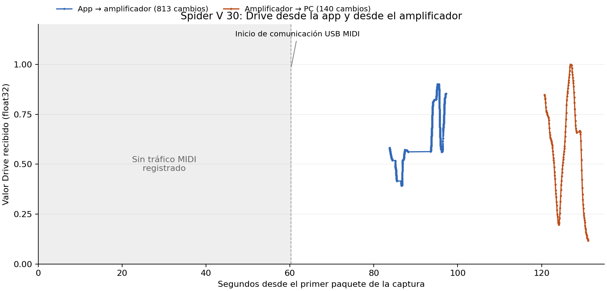

# Spider V 30: captura de Drive y control externo

Fecha de análisis: 17 de octubre de 2026, America/Mexico_City. Archivo aportado: `/workspace/attachments/61bdc038-8b34-48fc-8c44-f8520be47b2c/SpiderV_USB2perilla.pcapng .pcapng`.

**Conclusión:** con la sesión de Remote abierta, existe telemetría de Drive del amplificador hacia el PC, identificable y decodificable. Se extrajeron **140 notificaciones entrantes de `Amp.Drive`**, separadas de **813 cambios salientes de la app**. Los IDs se resolvieron contra una tabla enviada por el propio dispositivo, no sólo contra recursos de una aplicación antigua. Esto aporta la entrada necesaria para un futuro puente de controles hacia NAM externo; **no prueba ejecución de NAM dentro del amplificador ni constituye un puente funcionando en vivo**.

## Integridad, alcance y método

- Entrada: 664000 bytes; SHA-256 `101c25061d62c511b61a8635903da0b277a4379d918fde3e5f5a6167cea4c536`.
- 7950 paquetes PCAPNG, 133,188961 s de intervalo, sin truncación declarada. Se validaron longitudes/trailers de todos los bloques. La captura puede omitir operaciones anteriores a su comienzo; un archivo estructuralmente válido no prueba ausencia absoluta de pérdidas del capturador.
- VID/PID observados `0e41:5068`; bus 2, dirección 4. Se filtraron 7932 frames target. Los archivos de resultados omiten payloads de los otros dispositivos del controlador.
- Transporte observado: USB MIDI sobre bulk `0x02` OUT y `0x82` IN; cable MIDI 0. No se observaron MIDI CC estándar: se usan SysEx. El PCAP no contiene audio isócrono target activo.
- Se tomaron datos OUT sólo en submissions y datos IN sólo en completions, evitando duplicar transacciones. Reensamblado de 3219 SysEx: 1901 OUT y 1318 IN. Un parser independiente coincide en bytes, dirección, frames y tiempos de los 3219. No quedaron SysEx incompletos.
- 3216 mensajes usan envoltorio Parker `M`; los otros tres corresponden a identity/identificación extendida. Decodificación nativa contrastada con Ghidra; **3216 roundtrips decode→encode idénticos**.
- No se accedió al equipo ni se ejecutó Remote/driver/firmware. El análisis consiste en leer una captura de una sesión que el propietario ya realizó; no se reprodujo ningún mensaje.

Scripts: `analyze_capture.py`, `independent_validate.py`, `decode_parker.py`, `reassemble_protocol.py`. Detalles independientes de descriptores/URB: `USB_CAPTURE_VALIDATION.md`; correlación estática: `NATIVE_PACKET_CORRELATION.md`.

## Secuencia temporal y relación con el relato

Los tiempos son segundos relativos al primer paquete del archivo. No hay marcadores sincronizados de cada acción humana; la atribución app/perilla combina dirección, contenido, separación temporal y el relato del propietario.

| Intervalo / frames | Observación verificable | Interpretación y confianza |
|---|---|---|
| Inicio hasta 60,250494 s | Descriptores iniciales; no se registra bulk MIDI | Compatible con giro inicial sin Remote. No demuestra ausencia de eventos cuando no hay lecturas pendientes; confianza alta sobre el silencio, limitada sobre su causa |
| 60,250494 s; frame 25 | OUT MIDI Identity Request; IN desde frame 27 | Inicio de comunicación observable, coherente con apertura de Remote; no fecha exacta del clic humano |
| Desde 61,715269 s | Intercambio de versión, tabla de símbolos y otras consultas | Sesión inicializada; tabla recuperada en frames 47–1259 |
| 83,747070–97,246170 s; frames 2787–7663 | 813 cambios de Drive PC→amplificador | Movimiento del control en la app, confianza alta |
| 120,693903–131,116743 s; frames 7669–7947 | 140 notificaciones Drive amplificador→PC | Corresponden al giro físico descrito y a la UI siguiéndolo, confianza alta |

La última submission OUT con datos ocurre a **97,246170 s**. Durante las 140 notificaciones de Drive de la última fase **no hay mensajes OUT con payload hacia el dispositivo**, por lo que no son eco inmediato de nuevos setters del ratón ni respuestas intercaladas a consultas salientes de parámetros. Sí continúan lecturas USB IN del host: USB es sondeado por el host y «notificación» no significa una transmisión eléctrica sin solicitud IN.

El primer conjunto de descriptores tiene IRP ID cero y timestamp idéntico: probable snapshot de USBPcap. No se presenta como evidencia de reconexión física ni de SET_CONFIGURATION real al empezar la captura.

## Identidad y versión del dispositivo

Frame 20 contiene el descriptor `0e41:5068`. La correspondencia estática en Remote identifica ese PID como Spider V 30. El segundo SysEx de identificación contiene literalmente `L6ImageType:main` y `L6Version:2.0.5.0.0` (frames 27–29). Una respuesta de versión de la API contiene el DWORD **`0x02050030`**, coincidente con el campo de versión del SVU aportado en offset `0x18`. Se conserva la representación literal; no se inventa la semántica de cada subcampo ni una revisión de PCB.

## Framing y reensamblado correcto

SysEx Parker observado: `F0 00 01 0C 22 00 4D ... F7`. Los bytes 7–11 son canal, secuencia, fragmento y dos nibbles de longitud. Longitud raw del fragmento: `((byte[10] & 15) << 4 | (byte[11] & 15)) + 1`. Desde el byte 12, grupos de ocho bytes representan siete bytes originales: primer byte contiene los MSB; bit 6 corresponde al primer dato y bit 0 al séptimo. Se elimina padding sólo después de recuperar la longitud raw.

Las llamadas nativas de escritura pueden separar la cabecera API de su payload en SysEx distintos. Por ello **no se interpreta cada SysEx como una operación completa**. Se concatenaron los bytes por `(dirección, canal)` y se consumió cabecera de 8 bytes `{opcode:uint32LE, payload_length:uint32LE}`, seguida de exactamente `payload_length` bytes. Resultado: **2307 mensajes API**, cuatro streams y **cero bytes sin consumir**. Evidencia completa y procedencia por fragmento en `logical_messages.json`.

El encoder de la biblioteca host limita sus fragmentos a 210 bytes; en esta captura el dispositivo también envía fragmentos de 256 bytes, aceptados por el receptor. No se asume simetría de límites.

## Tabla de símbolos recibida del equipo

Respuesta API IN, canal 0, opcode 1, mensaje lógico 8: payload de **22175 bytes**, tabla de **916 símbolos**. Estructura `<count:uint32LE, size:uint32LE>`, registros de 12 bytes `<offset_pool, CRC32, longitud>` y pool UTF-8/NUL. Se comprobaron límites, longitudes, terminadores y **los 916 CRC32**.

SHA-256 de `device_symbol_reply.bin`: `f2bbfd4e6efde58a1589374d2f24e6860594c0bdea27faf06ec27d2ccefdb138`.

| Índice real | Texto | CRC32 | Offset del registro / cadena en tabla recibida |
|---:|---|---|---|
| 42 / `0x2a` | Amp | `0e4f5a33` | `0x200` / `0x2cc6` |
| 38 / `0x26` | Drive | `a9dcda8b` | `0x1d0` / `0x2c9d` |

Los primeros 910 nombres coinciden en orden con Parker del instalador. Las seis entradas adicionales son cadenas numéricas; no se atribuyen a seis funciones nuevas ni se establece si fueron internadas dinámicamente o vienen de una versión de firmware. Un futuro lector debe resolver la tabla de la sesión, sin prometer que los índices permanecen iguales en todo modelo/firmware.

## Datos de Drive y ejemplo verificable

| Sentido | Cabecera API | Payload de 16 bytes, DWORD LE |
|---|---|---|
| App→amplificador | opcode `0x0a`, longitud 16 | `[42, 38, 4, bits_float32]` |
| Amplificador→PC | opcode `0x04`, longitud 16 | `[42, 38, 4, bits_float32]` |

La semántica de `4` como discriminante float se corrobora estáticamente con `FUN_10097750`: la rama de tipo 4 compara el siguiente DWORD como float; existe una rama separada para tipo 2 entero. `FUN_100991b0` escribe cabecera y payload por separado; `FUN_1009ae80` consume cabecera, reconoce notificaciones opcode 4 y entrega IDs/pareja tipada a callbacks. No se han confundido estos números con direcciones de memoria ni con códigos MIDI CC.

Ejemplo final de giro físico, **frame 7947**, t=131,116743 s, endpoint `0x82`, completion USB exitosa. Paquete PCAPNG empieza en offset **663640**; payload USB MIDI en **663695**. El SysEx reconstruido tiene 45 bytes; después de MSB-unpack y truncado a 24 bytes se obtiene:

```text
04 00 00 00  10 00 00 00  2a 00 00 00  26 00 00 00
04 00 00 00  f0 f0 f0 3d
```

Es una notificación de `Amp.Drive` con float32 LE **0,1176470518**. Los cuatro bytes del float se recuperan del empaquetado MIDI; no están presentes necesariamente como cuatro bytes contiguos del archivo.

Resultados medidos:

- App: 813 valores, mínimo 0,392343849; máximo 0,901754141.
- Amplificador: 140 valores, mínimo 0,117647052; máximo 1,0; 138 valores float distintos.
- Mediana entre notificaciones físicas: **66,826 ms**; intervalo observado aproximadamente 60,0–734,075 ms. No es una medición de latencia desde el movimiento ni de frecuencia de muestreo del potenciómetro; no hubo referencia temporal externa del movimiento.
- La codificación float32 no demuestra resolución del ADC ni 32 bits de precisión efectiva del control físico.



## Qué permite para NAM y qué falta

**Demostrado:** el PC recibe valores Drive de la perilla en una sesión activa de Remote. No es sólo un setter del editor. Hay datos suficientes para diseñar un puente de controles externo.

**Preparado offline:** `drive_events.csv/json` contiene valores salientes y entrantes con frames/timestamps; `nam_control_events.jsonl` contiene sólo los 140 eventos entrantes, para reproducirlos hacia un controlador externo sin reenviar paquetes al amplificador. Este exportador no abre USB, no produce MIDI y no es un plugin de audio ni una integración NAM en vivo.

**Por resolver para un puente real:** cómo mantener la sesión/lectura sin conflicto con Remote y sin introducir escrituras no autorizadas; soporte de múltiples clientes del driver; elección del host/plugin externo y de su API de control. Un NAM no condicionado normalmente modela una configuración fija: esta perilla podría mapearse a ganancia de entrada u otro parámetro del host, pero no se promete que reproduzca el Drive interno del modelo original.

No se demuestra independencia de Remote, funcionamiento de todas las perillas, escritura de pantalla, audio sin modelado interno, latencia de audio ni funcionamiento de NAM dentro del DSP. Los descriptores anuncian audio estéreo PCM 16 bits a 44,1/48 kHz, pero no se activó ni midió esa ruta en esta captura. La identificación de CPU/DSP y memoria sigue pendiente.

## Siguiente prueba de lectura

Repetir una captura con Remote ya en el estado habitual y sin tocar sus controles: reposo, barrido lento de **una sola perilla**, reposo, siguiente perilla. Anotar los segundos aproximados de cada acción y los nombres/modos del panel; no guardar presets ni actualizar. Esto amplía el mapa de controles sin generar nuevas peticiones vendor, setters o reproducciones USB desde nuestras herramientas. No es necesario repetir Drive para aceptar el resultado ya observado; la siguiente captura puede centrarse en Bass/Mid/Treble/Volume.

Para estudiar independencia de Remote, hace falta una fase separada de seguimiento estático de inicialización y lectura: el silencio inicial de este archivo no autoriza a ejecutar su handshake ni a concluir que sea imposible escuchar sin Remote.

## Reproducción

```bash
python /workspace/analysis/captures/analyze_capture.py \
  '/workspace/attachments/61bdc038-8b34-48fc-8c44-f8520be47b2c/SpiderV_USB2perilla.pcapng .pcapng'
python /workspace/analysis/captures/independent_validate.py
python /workspace/analysis/captures/decode_parker.py
python /workspace/analysis/captures/reassemble_protocol.py
python /workspace/analysis/captures/plot_drive.py
```

No se incluye el PCAP original en el paquete de resultados porque contiene otros dispositivos; se conserva intacto en attachments. Los resultados de paquetes publicados corresponden al target identificado. El formato USBPcap se contrastó con `https://raw.githubusercontent.com/wireshark/wireshark/master/epan/dissectors/packet-usb.c`, copia local `wireshark_packet_usb.c`; la rama es mutable y su hash queda en el manifiesto del expediente.
