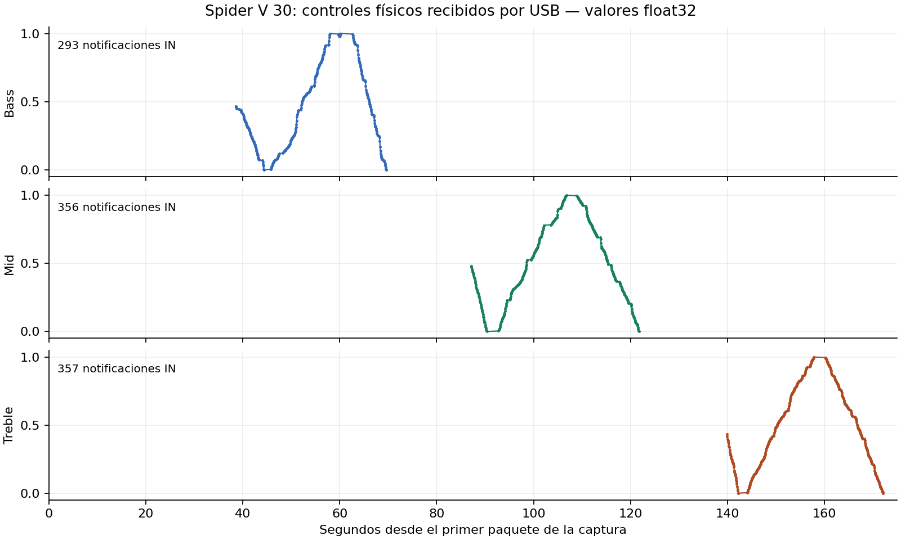

# Bass, Mid y Treble: telemetría física confirmada

Se analizó offline `/workspace/attachments/7b5b94c5-7925-4068-a345-574f6364cc53/SpiderV_Bass_Mid_Treble.pcapng`, **185548 bytes**, SHA-256 `fa12988477ae3c2952b89f81a5b429cb92a4a0123ff2033536eb116e60a05a91`. El original se conserva intacto. No se ejecutó Remote/driver ni se enviaron mensajes o solicitudes USB desde las herramientas de análisis.

**Resultado:** 1006 notificaciones del amplificador al PC: **293 Bass, 356 Mid y 357 Treble**. Todos los controles recorren valores float32 desde 0 hasta 1 en esta captura. No hay SysEx OUT, escrituras salientes de parámetros ni audio isócrono registrado. La secuencia coincide con las tres perillas solicitadas, en ese orden, con pausas intermedias. Junto con Drive de la captura anterior, hay cuatro controles físicos identificados para diseñar un puente externo.

## Validación

- PCAPNG: 2050 frames, duración relativa 174,134747 s. Bloques y longitudes válidos; ninguna truncación declarada. Un archivo válido no prueba ausencia absoluta de pérdidas previas del capturador.
- Descriptor del target: `0e41:5068`, bus 2/dirección 4; 2032 frames del target. Los resultados omiten payloads de otros dispositivos.
- 1013 SysEx, todos **IN**, por endpoint MIDI bulk `0x82`, cable 0. Se extraen datos de completions, sin duplicar las lecturas enviadas por el host. Los datos iniciales de control son snapshot/descriptores, no setters de parámetros.
- Dos parsers independientes coinciden exactamente en bytes, frames, dirección y tiempos de los 1013 SysEx. Sin SysEx incompletos ni errores de estado USB registrados.
- Los 1013 mensajes Parker M verifican roundtrip binario decode→encode idéntico. La longitud raw es 24 bytes en cada caso.
- Stream API: 1013 mensajes completos, cero bytes pendientes; **1006 opcode 4**, payload 16 bytes, y **7 opcode 3** con otro contenido. Los siete opcode 3 se excluyen del mapa de perillas; no se les asigna aquí una función no comprobada.

Scripts comunes: `../captures/analyze_capture.py`, `independent_validate.py`, `decode_parker.py`, `analyze_controls.py`. Resultados: `summary.json`, `independent_validation.json`, `controls_summary.json`, `logical_messages.json` y `control_events.csv/json`.

## Mapa y procedencia de los nombres

Cada notificación tiene cabecera `<opcode=4:uint32LE, payload_length=16:uint32LE>` y payload `<group_index, parameter_index, type=4, float32LE>`.

| Control | Grupo / parámetro | Notificaciones IN | Intervalo relativo | Frames primero–último | Valor observado |
|---|---|---:|---|---|---|
| Bass | 42 / 33 | 293 | 38,554697–69,606882 s | 25–611 | 0–1 |
| Mid | 42 / 35 | 356 | 87,139158–121,710052 s | 615–1329 | 0–1 |
| Treble | 42 / 36 | 357 | 139,883606–172,072504 s | 1333–2047 | 0–1 |

**No se capturó una tabla de símbolos nueva en este archivo**, coherente con una sesión ya abierta. Los nombres se resuelven usando la tabla de 916 símbolos validada en la captura anterior (`../captures/device_symbols.json`): índice 42=`Amp`, 33=`Bass`, 35=`Mid`, 36=`Treble`; antes se resolvió 38=`Drive`. El hash de la referencia queda en `controls_summary.json`. El orden de acciones y los cambios separados respaldan la correspondencia en esta sesión, confianza alta; no se atribuye una consulta nueva al dispositivo ni se promete que los IDs sean inmutables entre versiones/modelos.

El tipo 4 float y el encuadre provienen del seguimiento estático de APIV3EngineDLL y del roundtrip validado; ver `../captures/NATIVE_PACKET_CORRELATION.md`. La codificación float32 no indica resolución ADC de 32 bits, y el rango 0–1 no establece una curva de EQ en dB ni una frecuencia de corte.



## Implicación para NAM externo

Se demuestra disponibilidad de valores físicos para **Drive/Bass/Mid/Treble con Remote en sesión**, no solamente actualización de la UI. `../CONTROLS_MAP.json` reúne los cuatro controles con captura de origen e IDs. `nam_control_events.jsonl` exporta los 1006 eventos de esta captura; el archivo de Drive anterior conserva sus 140 eventos por separado. Sus tiempos pertenecen a capturas diferentes y no se concatenan como una sesión continua.

Estos exportadores sólo leen archivos; no son un puente en vivo, no abren MIDI y no alteran el amplificador. Un futuro puente debe comprobar sesión/lectura y compatibilidad con otros clientes antes de afirmar funcionamiento junto a Remote. Los mensajes son SysEx de parámetros, **no números MIDI CC estándar**.

Un modelo NAM no condicionado no expone automáticamente las perillas originales del amplificador entrenado. Una implementación externa puede mapear Drive a ganancia de entrada y Bass/Mid/Treble a un EQ del host, con curvas por diseñar; no se promete equivalencia con el circuito o algoritmo de tono del Spider. Queda pendiente elegir el host/plugin y probar audio/control en vivo.

**No hace falta otra captura de estos cuatro controles para aceptar su telemetría en sesión.** El siguiente paso útil es preparar el prototipo de escucha/puente para el host externo, manteniendo separada la investigación de DSP/memoria para NAM interno. No se ha probado independencia de Remote, control de pantalla ni ejecución interna de NAM.

## Reproducción

```bash
python /workspace/analysis/captures/analyze_capture.py \
  /workspace/attachments/7b5b94c5-7925-4068-a345-574f6364cc53/SpiderV_Bass_Mid_Treble.pcapng \
  --out /workspace/analysis/captures_tone
python /workspace/analysis/captures/independent_validate.py \
  --input /workspace/attachments/7b5b94c5-7925-4068-a345-574f6364cc53/SpiderV_Bass_Mid_Treble.pcapng \
  --directory /workspace/analysis/captures_tone
python /workspace/analysis/captures/decode_parker.py --directory /workspace/analysis/captures_tone
python /workspace/analysis/captures/analyze_controls.py \
  --directory /workspace/analysis/captures_tone --symbols /workspace/analysis/captures/device_symbols.json
python /workspace/analysis/captures_tone/make_outputs.py
```

El PCAP original contiene descriptores de otros dispositivos y no se incluye en el ZIP del expediente. Los scripts conservan los números de frame del archivo original para comprobar cada observación. Los hashes y validaciones finales figuran en el manifiesto.
